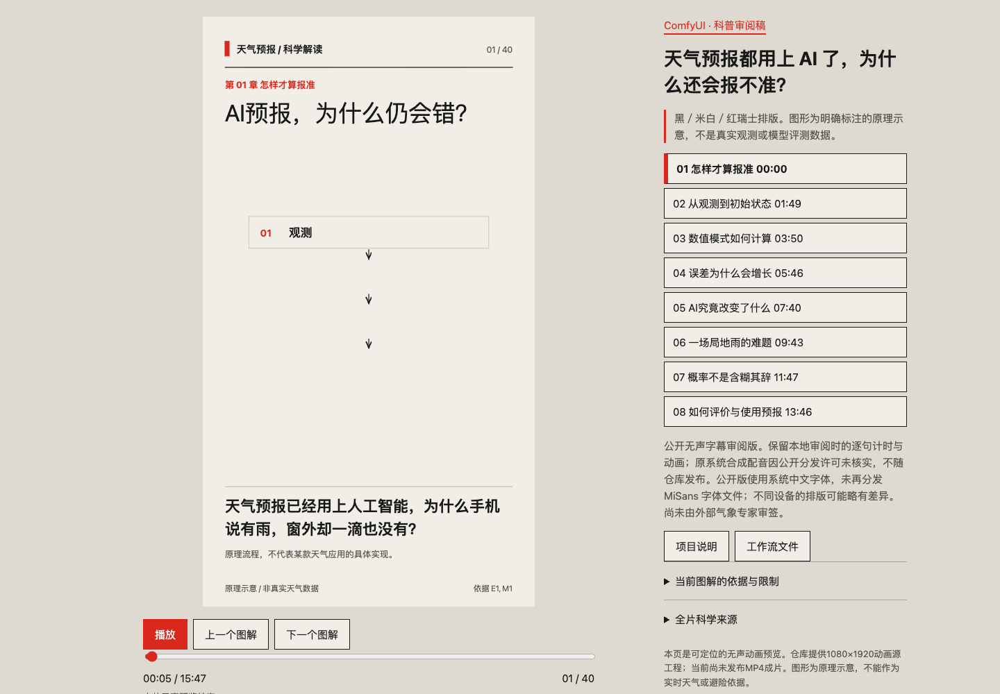

# Explainer Video Workflow

天气 AI 科普动画源工程与可复现的 ComfyUI 工作流。

当前主题：**《天气预报都用上 AI 了，为什么还会报不准？》**

> 当前交付为可播放的无声字幕动画源工程，**不是已导出的 MP4 成片**。本仓库不包含原本地配音、字体二进制、模型权重或私人素材，不提供一键生成任意主题视频的承诺。



## 项目规格

- 竖屏 1080 × 1920，时长 947.0416875 秒（约 15 分 47 秒）。
- 8 章节、40 场景、167 句字幕、40 幅程序化 SVG 科学示意图。
- 黑色／米白／红色的瑞士排版；系统字体；按绝对时间计算动画，可跳转、暂停和回看。
- 18 条资料索引，记录论据使用范围与局限；图解为教学示意，不是真实气象观测。
- Python 标准库构建；ComfyUI 可在 CPU 上执行，无需模型、GPU 或付费服务。

这是对现有项目的整理，而非重做视觉风格。RhineLabUI 是早期设计参考，当前工程没有复制其代码、品牌或模型，详见[第三方说明](THIRD_PARTY_NOTICES.md)。

## 快速预览

推荐 Python 3.10+。在仓库根目录执行：

```sh
python3 tools/build.py
python3 tools/check_content.py
python3 -m unittest discover -s tests -v
python3 -m http.server 3033 --bind 127.0.0.1
```

打开 <http://127.0.0.1:3033/projects/weather-ai/>。播放器提供播放／暂停、进度定位、上一场／下一场和章节跳转；当前版本没有音轨。直接双击 HTML 会受浏览器本地文件读取限制，请使用本地 HTTP 服务。

命令仅重新生成 SVG、SRT 和检查报告，不导出视频，不上传文件。

## ComfyUI 工作流

- [界面导入版：weather-silent.json](workflows/weather-silent.json)
- [API 提交版：weather-silent-api.json](workflows/weather-silent-api.json)
- [安装与使用指南](docs/COMFYUI.md)

五节点依次执行：读取讲稿与冻结计时 → 检查来源、字幕和时间线 → 生成科学图解 → 导出字幕 → 生成审阅报告。

本工作流是**现有工程的确定性构建流程**，不是扩散模型生视频流程。它不自动调研、不生成配音、不重新估计字幕时间，也不输出 MP4。

## 文件结构

- `projects/weather-ai/`：讲稿、资料索引、冻结时间线、播放器、字幕与 SVG。
- `comfyui/custom_nodes/explainer_public/`：公开自定义节点。
- `workflows/`：ComfyUI 界面图与 API 图。
- `tools/`：构建、图解生成、内容检查及可选浏览器／ComfyUI 验证脚本。
- `tests/`：14 项 Python 回归测试。
- `reports/`：已执行的本地检查结果与截图。
- `.github/workflows/validate.yml`：Python 3.10／3.13 自动检查配置。
- `docs/`：工作流指南、科学与授权边界、交付状态。

## 验证和维护

本地已执行 Python 构建、内容检查、14 项回归、浏览器检查和真实 ComfyUI API 图执行。具体结果及未覆盖范围见 [VERIFICATION.md](VERIFICATION.md)。远程持续集成状态以本仓库 GitHub Actions 为准；配置存在不等于已执行通过。

可选浏览器检查需要 Node.js 20+、已安装的 Chrome／Chromium，以及正在运行的本地预览服务：

```sh
npm ci --ignore-scripts
npm run test:browser
```

可用 `CHROME_PATH` 指定浏览器可执行文件，`PREVIEW_URL` 指定预览 URL。浏览器检查不属于基本播放或 Python 构建的必需依赖。

## 内容、授权和交付状态

- [完整讲稿](projects/weather-ai/SCRIPT.md) · [资料索引](projects/weather-ai/sources.json)
- [科学内容和素材边界](docs/SCIENCE-AND-RIGHTS.md)
- [当前交付状态](docs/PROJECT-STATUS.md)
- [第三方来源与版权说明](THIRD_PARTY_NOTICES.md)
- [修改与贡献规范](CONTRIBUTING.md)

当前未选定通用开源许可证，原创代码、讲稿与图解保留版权。公开可见不代表任意商用、改编或再分发许可；第三方权利各自适用。
