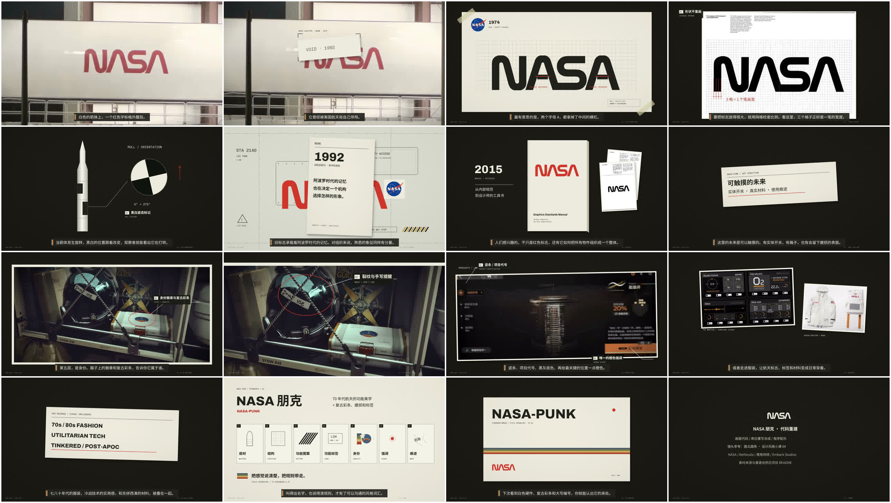

# NASA 朋克 · 代码重建版

从路北路陈的《设计风格小课 04》（[参考作品 BV1Tsps6kE6z](https://www.bilibili.com/video/BV1Tsps6kE6z/)）出发，用代码重建章节、讲解动作、字幕和声音。**不是参考作品的原工程，不是逐帧 1:1 复刻，不是其官方版本。**

## 观看与文件

- [在线播放与章节跳转](https://yenicee1014.github.io/Explainer-Video-workflow/nasa-punk.html)
- [完整 MP4](../../video/nasa-punk-full-rebuild.mp4)
- [中文字幕 SRT](captions.srt) / [WebVTT](captions.vtt)
- [制作过程解析](WORKFLOW.md)
- [源码快照、复用范围与缺失依赖](source/README.md)
- [素材来源与权利说明](SOURCES_AND_RIGHTS.md)
- [媒体规格及 SHA-256](delivery-manifest.json)
- [核验范围与待审事项](verification/README.md)

发布日期：2026-10-27。成片 358.466667 秒（05:58.47），1280×720、30fps、10,754 帧，H.264 视频与 AAC 双声道 48kHz 音频，38,434,507 字节。14 个代码场景，67 句普通话旁白，程序生成配乐。

## 和参考作品有什么不同

| 项目 | 当前代码重建版 |
| --- | --- |
| 结构 | 参考历史叙事与案例次序，另设收束与署名场景，共 14 场 |
| 台词 | 重新撰写，见 [rebuild-script.json](source/rebuild-script.json) |
| 旁白 | macOS Tingting 逐句合成，不是 MiniMax，不冒充原作者的声音 |
| 配乐 | NumPy 合成音床、短提示音与章节声标，不是原片音乐 |
| 视觉 | HTML / SVG / CSS / GSAP 重新编排，部分案例沿用参考作品分离出的静帧 |
| 时间 | 本版 358.466667 秒，参考文件实测 353.877333 秒；不能套用原版章节时码 |
| 对齐 | 实测句级录音边界；句内动作另设相对偏移，没有词级强制对齐 |
| 完成度 | 已导出全片并完成媒体与自动核验，完整人工听看和逐字校对尚未完成 |

## 本版章节

| 起点 | 章节 | 核心讲解动作 |
| --- | --- | --- |
| 00:00.00 | 一个被废过的标志 | 箭体字标、退役纸条与风格彩条 |
| 00:12.00 | 1974 年的提案：蠕虫 | 统一笔画，显示并移除 A 的横杠 |
| 00:43.00 | 一本管住一切的手册 | 三格笔宽测量、误用示范、实物应用 |
| 01:31.53 | 为什么它看起来像未来 | 箭体端面旋转，比较黑白标记相位 |
| 01:49.53 | 1992 年，蠕虫被废 | 功能标签与身份标记，字标被覆盖替换 |
| 02:28.03 | 设计师没忘 | 手册再版与视觉系统，2020 年回到箭体 |
| 02:52.03 | 《星空》：NASA 朋克 | 现实设备与游戏材料的并置比较 |
| 03:23.03 | 拆一张《星空》截图 | 同图七层，定位结构、标签、红色拉片与裂纹 |
| 04:15.30 | 明日方舟「孤星」 | 竖条、按钮、公告页与同心圆对照 |
| 04:31.97 | 各有各的长法 | 电影、服装与游戏的关联板 |
| 04:50.50 | ARC Raiders 的美术 | 色块、轮廓、拼装与磨损比较 |
| 05:27.60 | 风格卡 | 汇总七层视觉词汇 |
| 05:40.47 | 五十年前的未来 | 回到封面并留出阅读时间 |
| 05:52.47 | 代码重建 | 参考作者、制作方式与素材署名 |

精确秒数来自 [实测时间轴](source/rebuild-timeline.json)，播放器使用同一组章节锚点。

## 当前验收边界

- 已完成：31 秒先行样段、全片导出、完整解码、关键帧检查、首中尾抽帧，以及输出音轨的三段数值同步检查。
- 自动检查：15 个 HTML 文件；lint、runtime、layout 和 motion 无错误；布局有一条有意裁切的信息记录；另有 **38 条 craft 节奏 / 设计启发式警告**，并非零警告交付。
- 对比度检查只抽样，不代表全片所有文字与像素均已检查。
- 未完成：全片正常速度人工听看、逐字人工校对、词级对齐、全部外部素材及系统声音再分发许可逐项确认。

素材有出处不等于取得再分发许可。此归档不授予游戏、电影、服装、NASA 标识或参考作者作品的权利；不要把成片或联系表当成可自由商用素材包。

